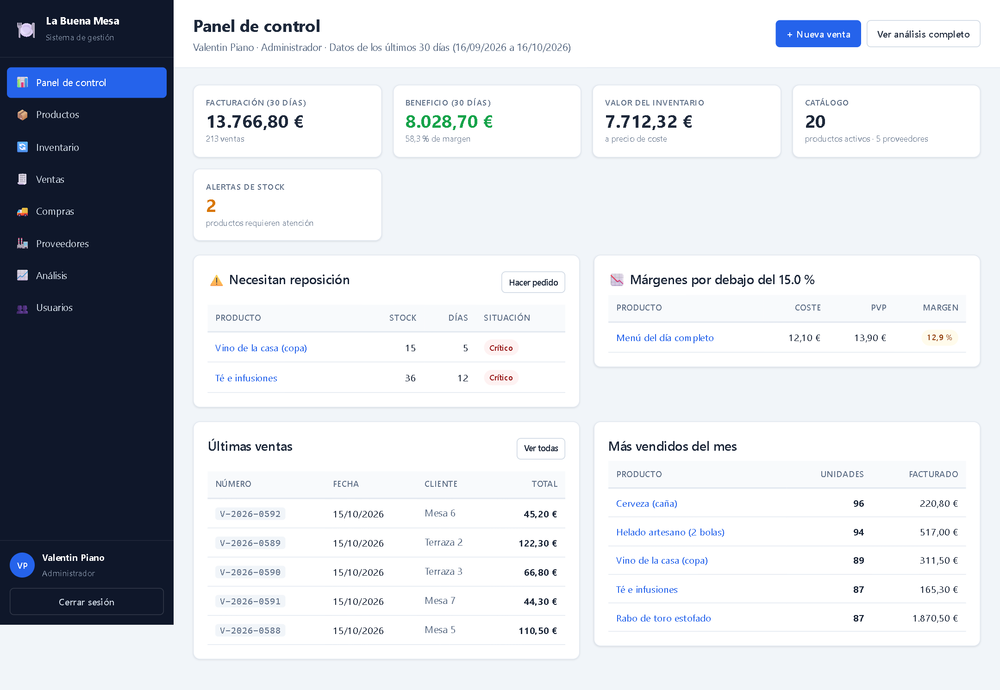
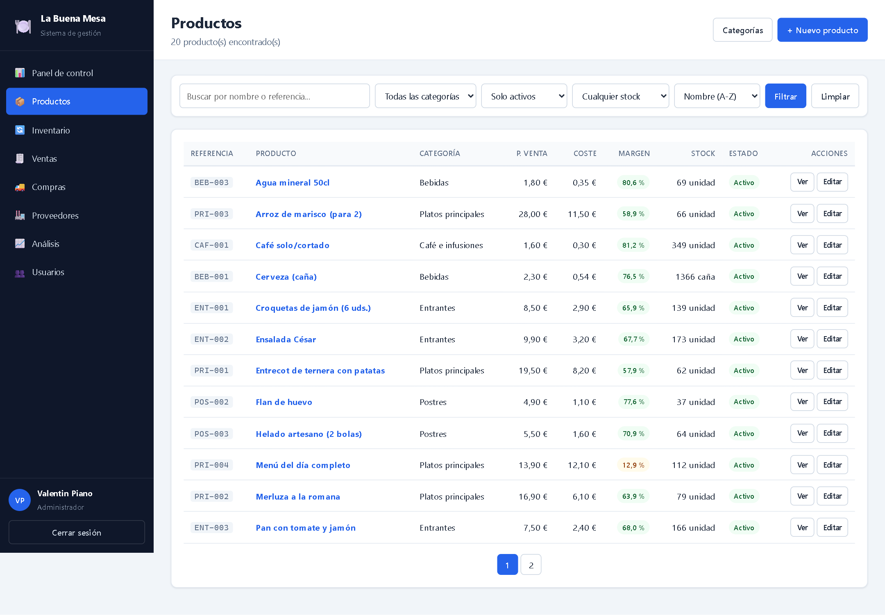
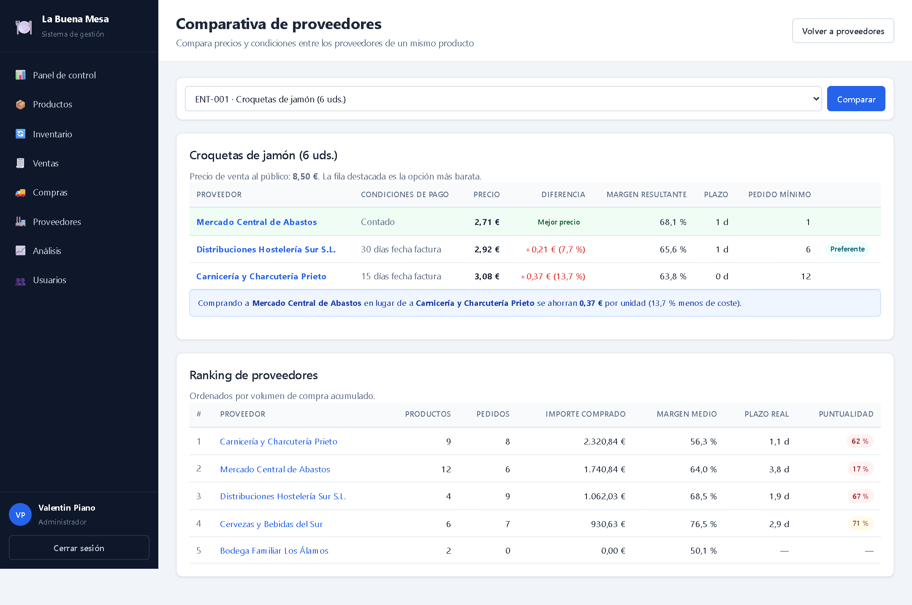
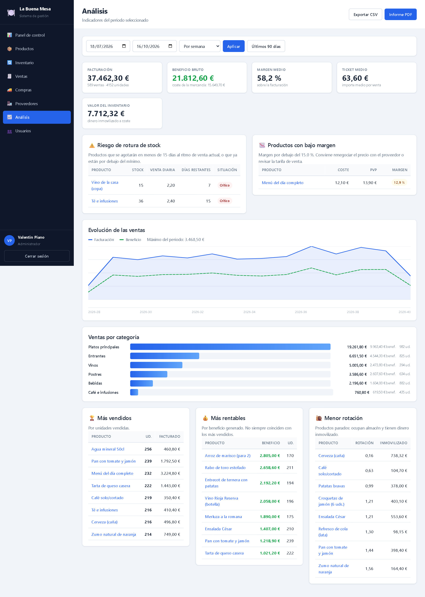
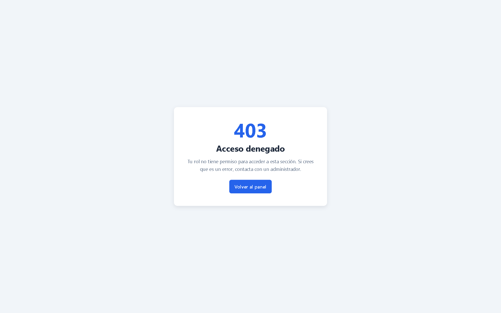

# La Buena Mesa: gestión de inventario y ventas para restaurantes

Aplicación web en **Python y Flask** para llevar el día a día de un restaurante:
carta y stock, ventas, compras a proveedores y análisis de rentabilidad.
Proyecto final del curso de Programación en Python de Tokio School.

## Qué hace

- **Carta e inventario.** Productos con precio, coste y margen, stock mínimo,
  ubicación y alertas de stock bajo. Cada movimiento de stock queda registrado
  con su usuario responsable.
- **Venta por raciones.** Un producto puede comprarse por envase y venderse por
  ración (un barril de 30 L que se sirve en cañas, una botella de vino por
  copas). El stock y el coste por ración se calculan solos.
- **Ventas y compras.** Registro de tickets y pedidos a proveedor. Las compras
  suben el stock y las ventas lo bajan, siempre a través de un único servicio.
- **Proveedores.** Ficha de cada proveedor, sus tarifas por producto y una
  comparativa de precio y cumplimiento del plazo de entrega.
- **Análisis.** Productos más vendidos y más rentables, rotación, beneficio por
  periodo, evolución de ventas por categoría, productos con bajo margen y
  previsión de días hasta agotar existencias.
- **Informes.** Exportación del catálogo y de las ventas a CSV e informe en PDF.
- **Roles y permisos.** Administrador, responsable de almacén y responsable
  financiero, cada uno con acceso solo a lo que necesita.

## Capturas

| Panel de control | Carta e inventario |
|---|---|
|  |  |
| **Comparativa de proveedores** | **Análisis de ventas y rentabilidad** |
|  |  |

El responsable de almacén no ve costes ni márgenes, y el acceso a zonas sin
permiso devuelve un 403:

| Productos vistos desde almacén | Acceso denegado |
|---|---|
|  |  |

Las 23 capturas están en [`docs/capturas/`](docs/capturas). Se generan solas
con `python docs/generar_capturas.py`, que crea una base de datos temporal con
los datos de demostración, arranca la aplicación y recorre cada pantalla con
Playwright.

## Tecnologías

Python 3.12 · Flask · SQLAlchemy · SQLite · Flask-Login · Flask-WTF (CSRF y
validación de formularios) · Jinja2 · ReportLab (PDF)

## Puesta en marcha

Necesitas **Python 3.10 o superior**. No hace falta instalar ningún servidor de
base de datos: el proyecto usa SQLite.

```bash
git clone https://github.com/<tu-usuario>/gestion-inventario-flask.git
cd gestion-inventario-flask

python -m venv venv
venv\Scripts\activate          # Windows
# source venv/bin/activate     # Linux / macOS

pip install -r requirements.txt

flask init-db          # crea instance/suministros.db
flask crear-admin      # pide nombre, correo y contraseña del administrador
flask cargar-demo      # opcional: carta y datos de ejemplo
python run.py
```

Abre <http://127.0.0.1:5000> e inicia sesión.

### Datos de demostración

`flask cargar-demo` crea 6 categorías, 20 productos de carta, 5 proveedores con
sus tarifas, 12 semanas de compras y 90 días de ventas. Incluye casos límite a
propósito: un plato con margen bajo, una bebida sin stock y un proveedor sin
compras registradas.

También crea dos usuarios de prueba (solo para uso local):

| Correo | Contraseña | Rol |
|---|---|---|
| `sala@labuenamesa.com` | `Sala12345` | Responsable de almacén |
| `financiero@labuenamesa.com` | `Finanzas1234` | Responsable financiero |

### Configuración

Los valores se leen de variables de entorno, con un valor por defecto pensado
solo para desarrollo:

| Variable | Para qué sirve |
|---|---|
| `SECRET_KEY` | Firma la cookie de sesión y los tokens CSRF. **Obligatorio cambiarla fuera de desarrollo.** |
| `DATABASE_URL` | Cadena de conexión de SQLAlchemy (por defecto, SQLite en `instance/`) |
| `NOMBRE_APP` | Nombre del negocio que aparece en la interfaz y en el PDF |

## Roles y permisos

| Acción | Administrador | Almacén | Financiero |
|---|:---:|:---:|:---:|
| Consultar la carta | ✔ | ✔ | ✔ |
| Crear y editar productos | ✔ | ✔ | ✖ |
| Ver costes y márgenes | ✔ | ✖ | ✔ |
| Registrar movimientos de stock | ✔ | ✔ | ✖ |
| Registrar ventas y compras | ✔ | ✔ | ✖ |
| Gestionar proveedores | ✔ | ✔ | ✖ |
| Ver análisis | ✔ | ✔ | ✔ |
| Ver beneficios y rentabilidad | ✔ | ✖ | ✔ |
| Generar informes | ✔ | ✔ | ✔ |
| Administrar usuarios | ✔ | ✖ | ✖ |

El registro público solo crea usuarios de almacén, para que nadie pueda darse
permisos de administrador desde la web.

## Estructura

```
app/
├── __init__.py      Fábrica de la aplicación (create_app)
├── config.py        Configuración y umbrales de negocio
├── extensions.py    SQLAlchemy, Flask-Login y CSRF
├── cli.py           Comandos de consola (init-db, crear-admin, cargar-demo)
├── datos_demo.py    Generador de datos de ejemplo
├── models/          Tablas como clases (usuario, producto, proveedor, venta, compra, inventario)
├── forms/           Formularios y validaciones
├── routes/          Rutas agrupadas por área (blueprints)
├── services/        Lógica de negocio (stock, ventas, proveedores, análisis)
├── utils/           Decoradores de permisos y menú
├── templates/       Plantillas Jinja2
└── static/css/      Hoja de estilos
docs/                Capturas y script que las genera
run.py               Punto de entrada
```

Decisiones de diseño:

- **Toda modificación de stock pasa por `services/inventario.py`**, así cada
  cambio deja un movimiento trazable y no hay dos sitios que calculen el stock.
- **Los servicios devuelven datos, no HTML**, de modo que el mismo cálculo
  alimenta la web, el PDF y las exportaciones CSV.
- **Las contraseñas se guardan como hash** con sal (Werkzeug) y todos los
  formularios llevan protección CSRF.

## Solución de problemas

- **`flask` no se reconoce como comando:** activa el entorno virtual.
- **`no such table: usuarios`:** falta ejecutar `flask init-db`.
- **El puerto 5000 está ocupado:** cambia el puerto en la última línea de `run.py`.
- **Empezar de cero:** borra `instance/suministros.db` y vuelve a `flask init-db`.

## Autor

Valentin Piano
